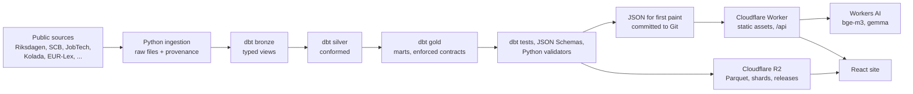

# Anton Ernstsson · data portfolio

[](https://github.com/korv9/anton-portfolio/actions/workflows/ci.yml)
[](https://github.com/korv9/anton-portfolio/actions/workflows/security.yml)
[](https://github.com/korv9/anton-portfolio/actions/workflows/build-warehouse.yml)

A data platform for Swedish and EU public data, the products built on it, and the portfolio
site that shows them: [antonernstsson.com](https://antonernstsson.com) ·
[github.com/korv9/anton-portfolio](https://github.com/korv9/anton-portfolio).

## What it is

**The data platform.** Python ingestion keeps every raw file with its URL, fetch time and
SHA-256. dbt on DuckDB builds bronze, silver and gold. dbt tests, enforced model contracts,
JSON Schemas and Python validators run before anything is published, and each publish is a
versioned release in Cloudflare R2. One command, `python platform/pipeline.py`, runs every
subject the same way on a laptop and in GitHub Actions. In numbers[^count]: 19 ingestion
packages, 26 pipeline subjects, 329 dbt models (158 with an enforced contract), 6,396 published
files and 14 workflows. The [platform case study](docs/case-studies/platform.md) covers the
design and what went wrong.

**The job assistant.** The second flagship uses the same platform end to end. An hourly run
reads Data/IT job ads from JobTech, compares each one with the owner's approved CV profile, and
publishes the matches as a released delivery group. Every judgement quotes the sentence in the
ad and the line in the CV it rests on; there is no hiring-chance percentage
([job assistant](docs/job-assistant.md)).

**Research.** Analyses built on the same pipeline: the SWEDEN research pages, text labs on
myth, philosophy and concepts, clustering experiments, and pre-registered studies whose
method is fixed in a dated document before the results exist.

The published build shows the home page only: profile, experience, the project list and a
chart feed. Every other page runs in the dev server and the browser tests while it is refined
(`START_ONLY` in [frontend/src/router.ts](frontend/src/router.ts)).

## Architecture



The site reads committed JSON and the Parquet and shard addresses in `delivery.json`; it does
not read the R2 releases yet ([storage and serving](docs/storage-and-serving.md)). Heavy text
and ML work runs once in Python and ships as compact files; the browser does vector search and
cheap metrics only.

## Stack

| Layer | Tools |
|---|---|
| Ingestion and ML | Python, pandas, sentence-transformers, scikit-learn, UMAP, HDBSCAN |
| Warehouse | DuckDB, dbt-core with dbt-duckdb |
| Delivery | Cloudflare R2 (versioned releases), JSON, Parquet |
| Serving | Cloudflare Workers static assets, Workers AI, D1 (job assistant) |
| Frontend | React, TypeScript, Vite, three.js, hyparquet |
| Tests | pytest, dbt tests, Node test runner, Playwright, axe |
| Infrastructure | GitHub Actions, Terraform for Cloudflare and GitHub |

## Repository map

| Folder | What it holds |
|---|---|
| [`platform/`](platform/README.md) | Ingestion, dbt models, publishing, quality checks, the pipeline registry and the Python tests |
| [`ml/`](ml/README.md) | The analysis and ML layer: clustering, model cards, pre-registered studies |
| [`frontend/`](frontend/README.md) | The React site, its committed data (`public/data/`) and the browser and unit tests |
| `worker/` | The Cloudflare Worker: static assets, the Workers AI endpoints, the job assistant API |
| [`configs/`](configs/README.md) | Delivery groups and schemas, clustering settings, Workers AI settings |
| [`scripts/`](scripts/README.md) | Verification, build checks and workspace tools |
| [`infra/`](infra/README.md) | Terraform for Cloudflare and GitHub |
| [`docs/`](docs/README.md) | One document per topic, grouped in the docs index |
| `warehouse/` | The local DuckDB warehouse and raw files; gitignored, stored in R2 |

## Run it

```bash
npm ci
npm run dev            # http://127.0.0.1:5173, every page
npm run verify:quick   # types, formatting, frontend and Worker unit tests
```

The site's data is committed, so it builds with Node alone. To rebuild a subject, install
`platform/requirements.txt`:

```bash
python platform/pipeline.py list            # every subject, its group and schedule
python platform/pipeline.py run welfare     # fetch, build, test, export
python platform/pipeline.py check           # the data validators (npm run data:check)
python -m pytest platform/tests -q
```

`npm run verify:full` adds the production build, the Python suite and the browser tests;
data and delivery changes also need `npm run verify:delivery`. GitHub runs the full CI on
every pull request. Scopes, logs and workspace rules are in
[the development workflow](docs/development.md).

## Documentation

- [Docs index](docs/README.md): platform, delivery, products, research and operations
- [Pipeline](docs/pipeline.md) and [storage and serving](docs/storage-and-serving.md)
- [Job assistant](docs/job-assistant.md) and [SWEDEN](docs/sweden-design.md)
- [Hosting](docs/deploy.md), [security](docs/security.md) and [incidents](docs/incidents/)

[^count]: Counted on 2026-10-23 from this branch. Ingestion packages: folders under
    `platform/ingest/`. Subjects: entries under `subjects:` in `platform/pipeline.yml`. dbt
    models: `.sql` files under `platform/models/`. Contracts: `enforced: true` lines in
    `platform/models/**/*.yml`. Published files: entries in `frontend/public/data/catalog.json`.
    Workflows: files in `.github/workflows/`.
