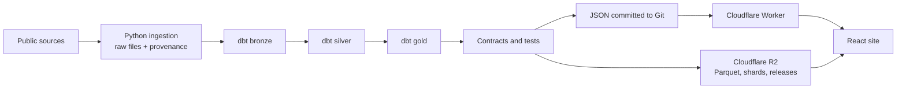

# Anton Ernstsson · data portfolio

[](https://github.com/korv9/anton-portfolio/actions/workflows/ci.yml)
[](https://github.com/korv9/anton-portfolio/actions/workflows/security.yml)

This repository holds a data platform that builds analyses from Swedish and EU public data,
and the portfolio site that shows them, live at https://antonernstsson.com.

The site is hosted on Cloudflare (Workers static assets; see [hosting](docs/deploy.md)).
Swedish is the default language, English one click away. The platform is described in the
[platform case study](docs/case-studies/platform.md), and what went wrong in
[docs/incidents/](docs/incidents/).

## How the data flows



Python ingestion keeps every raw file with its URL, fetch date and SHA-256. dbt on DuckDB
builds bronze, silver and gold. dbt tests, enforced model contracts, JSON Schemas and Python
validators run before anything is published. JSON for first paint ships with the site;
Parquet and document shards are read from R2. Heavy text and ML work runs once in Python and
ships as compact files; the browser computes only cheap, testable metrics. See
[platform/README.md](platform/README.md), [storage and serving](docs/storage-and-serving.md)
and the [data dictionary](docs/data-dictionary.md).

One command runs every subject, `python platform/pipeline.py`, locally and in GitHub
Actions: jobs, news and public data are refreshed every morning, the whole warehouse is
rebuilt every Saturday, and each run publishes a versioned release to R2
([pipeline](docs/pipeline.md)).

## What is on the site

The homepage contains the profile, experience and project index. The shared header groups
projects into Labs and Engineering; labs use continuous reports and section links. The
observatories are withdrawn: their addresses lead to the chart feed at
`#what-does-it-even-mean`. See [site structure](docs/site-structure.md)
and the [design system](docs/design-system.md).

| Group       | Project                 | Address                   |
| ----------- | ----------------------- | ------------------------- |
| Lab         | Symbol Lab              | `#symbolic-atlas`         |
| Lab         | Philosophy Lab          | `#philosophy-atlas`       |
| Lab         | Concept Lab             | `#concept-journey`        |
| Lab         | Drug Synergy Lab        | `#drugcomb`               |
| Engineering | IT Incident Clustering  | `#thesis`                 |
| Engineering | Homie API               | `#homie`                  |
| Engineering | DiVA Thesis Lakehouse   | `#diva-lakehouse`         |
| Tool        | Cluster Visuals         | `#cluster-visuals`        |
| Tool        | What does it even mean? | `#what-does-it-even-mean` |

Data models, source documentation and pipeline code remain in the repository. The former
standalone platform pages are retired from the website.

[Job Intelligence](docs/job-intelligence.md) is withdrawn from the site. Its source in `frontend/src/{compliance,companies,job-intelligence}` stays unrouted because the compliance release hash and build checks read it.

## Run locally

```bash
npm ci
npm run dev        # http://127.0.0.1:5173
```

During development:

```bash
npm run verify:quick   # types, formatting and unit tests; no browser or live-data validation
```

Run the tests for the behavior you changed as well. Before integration, run
`npm run verify:full`; delivery changes also require `npm run verify:delivery`.
See [development workflow](docs/development.md) for scopes, logs, resource checks
and safe workspace retirement. GitHub runs complete CI for pull requests and main.

A snapshot of the site's JSON is checked in, so the site builds with Node alone. To rebuild a
subject, install `platform/requirements.txt` and run it:

```bash
python platform/pipeline.py list            # every subject, its group and schedule
python platform/pipeline.py run welfare     # fetch, build, test, export (npm run welfare)
python platform/pipeline.py check           # the four data contracts (npm run data:check)
```

`npm run data:build` runs the builders that are not yet in dbt.

## Repository

| Folder | What it holds |
| --- | --- |
| `platform/` | Ingestion, dbt models (`models/`), publishing, quality checks and their tests |
| `frontend/` | The React/TypeScript site (`src/`), its published data (`public/data/`) and tests (`tests/`) |
| `worker/` | The Cloudflare Worker: static assets and the Workers AI endpoints |
| `ml/` | The NLP/ML layer with its own environment and model cards |
| `configs/` | Delivery groups and schemas, clustering and Workers AI settings |
| `infra/` | Terraform for Cloudflare and GitHub |
| `scripts/` | Verification, build checks and workspace tools |
| `docs/` | One document per product, plus pipeline, delivery, design and hosting. Start at [docs/README.md](docs/README.md) |
| `warehouse/` | The local DuckDB warehouse and raw files; gitignored, stored in R2 |

## Politics metrics (withdrawn observatory)

**Definitions.**

| Metric                   | Definition                                                                                                                                                                          |
| ------------------------ | ----------------------------------------------------------------------------------------------------------------------------------------------------------------------------------- |
| Party position           | The vote most of the party's members cast in a roll call, as Riksdagen reports it.                                                                                                  |
| Party cohesion           | Cast votes (yes, no, abstain) by the party's members that match the party position, of all their cast votes.                                                                        |
| Party similarity         | Of the roll calls where both parties had a position, the share where it was the same.                                                                                               |
| Polarisation (roll call) | 1 − (members in the largest group of parties with the same position) / (members of all parties with a position). 0 when all parties agree, about 0.5 at an even split.              |
| Polarisation (area)      | The mean polarisation of the roll calls prepared by that committee.                                                                                                                 |
| Close vote               | A roll call where \|yes − no\| / (yes + no) < 10 %.                                                                                                                                 |
| Topic share              | The learned issue lexicon (log-odds with an informative Dirichlet prior, about two thirds right on held-out speeches) applied to the words; each topic's share of the scored words. |
| Distinctive words        | tf-idf per party and party-leader debate: term frequency per 10,000 words × log(documents / documents with the term); names left out.                                               |
| Term growth              | Per 10,000 words in the issue debates, the latest riksmöte against the three before; ratio smoothed by +0.5 per 10,000 words; stems in at least 25 speeches.                        |
| Member deviation         | Cast votes that differ from the party position, of the cast votes where the party had one. Absence and deviation are not opposition by themselves.                                  |
| Voting map               | PCA of the parties' positions over the roll calls (yes 1, no −1, abstain 0), centred per roll call.                                                                                 |

**Data quality.** Before any metric, `cleanVotes` drops duplicate decision points, roll calls
where no party had a position, and roll calls with fewer than 100 cast votes, and the page
reports how many of each it found. Members who changed party are compared with the party they
belonged to at each vote.

**Design decisions.** Heavy text processing runs once in Python and ships as compact JSON;
vote metrics are cheap enough to compute in the browser from the per-session indexes, so they
stay transparent and testable. Party colours and logos come from one config
(`parties/identity.tsx`). Every chart has a text alternative, a table or labelled values, and
never relies on colour alone. The party, debate and member chosen are kept in the address.
