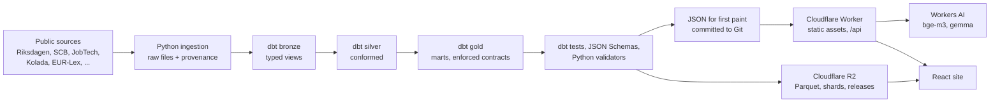

# Anton Ernstsson · data portfolio

A data platform for Swedish and EU public data, the products built on it, and the site that
shows them.

**Live: [antonernstsson.com](https://antonernstsson.com)**

## What it shows

- A data platform: Python ingestion keeps every raw file with its URL, fetch time and SHA-256,
  dbt on DuckDB builds bronze, silver and gold, and nothing is published before dbt tests,
  model contracts, JSON Schemas and Python validators pass. Each publish is a versioned release
  in Cloudflare R2, and `python platform/pipeline.py` runs every subject the same way on a laptop
  and in GitHub Actions.
- A job assistant on the same platform: an hourly run reads Data/IT job ads from JobTech,
  compares each with an approved CV profile and publishes the matches. Every judgement quotes
  the sentence in the ad and the line in the CV it rests on.
- Research on the same pipeline: the SWEDEN research pages, text labs on myth, philosophy and
  concepts, clustering experiments, and studies whose method is fixed in a dated
  pre-registration before the results exist.

## Architecture



The site reads committed JSON and the Parquet and shard addresses in `delivery.json`; only the
job assistant's files come from the active R2 release. Heavy text and ML work runs once in
Python and ships as compact files, so the browser does vector search and cheap metrics only.

## Stack

| Layer | Tools |
|---|---|
| Ingestion and ML | Python, pandas, sentence-transformers, scikit-learn, UMAP, HDBSCAN |
| Warehouse | DuckDB, dbt-core with dbt-duckdb |
| Delivery | Cloudflare R2 (versioned releases), JSON, Parquet |
| Serving | Cloudflare Workers static assets, Workers AI, D1 (job assistant) |
| Frontend | React, TypeScript, Vite, three.js, hyparquet |
| Tests | pytest, dbt tests, Node test runner, Playwright, axe |
| Infrastructure | GitHub Actions, Terraform for Cloudflare and GitHub |

## Run it

```bash
npm ci
npm run dev            # http://127.0.0.1:5173, every page
npm run verify:quick   # types, formatting, frontend and Worker unit tests
```

The site's data is committed, so it builds with Node alone. Rebuilding a subject and the
fuller checks are in [the pipeline](docs/platform/pipeline.md) and
[the development workflow](docs/platform/development.md).

## Read next

1. [Platform case study](docs/case-studies/platform.md): the problem, the decisions, what failed
2. [Pipeline](docs/platform/pipeline.md): how a subject gets from source to release
3. [Job assistant](docs/products/jobs/job-assistant.md): the second flagship, end to end
4. [Quality and validity](docs/platform/quality-and-validity.md): what the checks prove and what they do not
5. [Docs index](docs/README.md): every other document, by topic

Most of the code is written with AI agents; [CLAUDE.md](CLAUDE.md) holds the rules they work by.

## Repository map

| Folder | What it holds |
|---|---|
| [`platform/`](platform/README.md) | Ingestion, dbt models, publishing, quality checks, the pipeline registry and the Python tests |
| [`ml/`](ml/README.md) | The analysis and ML layer: clustering, model cards, pre-registered studies |
| [`frontend/`](frontend/README.md) | The React site, its committed data (`public/data/`) and the browser and unit tests |
| `worker/` | The Cloudflare Worker: static assets, the Workers AI endpoints, the job assistant API |
| [`configs/`](configs/README.md) | Delivery groups and schemas, clustering settings, Workers AI settings |
| [`scripts/`](scripts/README.md) | Verification, build checks and workspace tools |
| [`infra/`](infra/README.md) | Terraform for Cloudflare and GitHub |
| [`docs/`](docs/README.md) | One document per topic: platform, products, research, SWEDEN, decisions |
| `warehouse/` | The local DuckDB warehouse and raw files; gitignored, stored in R2 except folders kept local ([storage and serving](docs/platform/storage-and-serving.md)) |
| `PROJECTS.md`, `CONTINUITY.md` | What each project is and where it stands; where the last session stopped |
