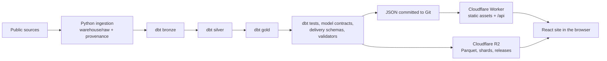

# Case study: the data platform

This page describes the data platform behind
[antonernstsson.com](https://antonernstsson.com): what it had to do, how it is built, what
went wrong, and how big it is. Every number below was counted from the repository on
2026-10-23 (the dbt, subject and workflow rows on 2026-10-25), and the method is given next to
it.

## Problem

The site shows analyses of Swedish and EU public data: Riksdag votes and speeches, JobTech
job ads, SCB and Kolada statistics, the EU AI Act, OECD tax tables and more. The data
arrives in many formats (REST APIs, PX-Web tables, XML archives, PDFs, RSS feeds), changes
on different schedules, and some sources cannot be fetched twice. The platform had to:

- keep every raw file with its URL, fetch date and SHA-256, so any published number can be
  traced back to a source file;
- refresh daily and rebuild weekly without anyone at the keyboard;
- fail loudly when a source changes shape, instead of publishing a wrong chart;
- serve a static site fast, including files too large to commit to Git;
- cost nothing to run beyond the domain.

## Architecture

| Stage | Where | What it does |
|---|---|---|
| Ingestion | `platform/ingest/`, `platform/lib/rawstore.py` | One package per source. Each raw file is written with a manifest line: URL, fetch time, SHA-256. |
| Transformation | `platform/models/` | dbt on DuckDB. Bronze types the raw records, silver conforms them, gold holds the shared dimensions (`models/gold/shared/`) and the marts the site reads. |
| Checks | `platform/models/**/schema.yml`, `configs/delivery/schemas/`, `python platform/pipeline.py check` | dbt tests and enforced model contracts, JSON Schemas for delivered files, and Python validators that reconcile delivered totals against the warehouse. |
| Delivery | `frontend/public/data/`, `platform/publish/release.py` | JSON for first paint is committed and ships with the site. Parquet marts and document shards live in R2; the browser reads them from the addresses in `delivery.json`. Each publish step also uploads a versioned release, reads every file back to compare bytes, and activates it last. The site does not read those releases yet ([storage and serving](../storage-and-serving.md)). |
| Serving | `worker/index.ts` | A Cloudflare Worker serves the static assets, two Workers AI endpoints and the job assistant's owner records (`/api/jobs/*`), which answer 503 until the D1 database is bound in `wrangler.toml`. |
| Orchestration | `platform/pipeline.yml`, `platform/pipeline.py` | Lists every subject with its stages and schedule, and runs them the same way locally and in GitHub Actions. |

## Key decisions

### DuckDB with dbt

The warehouse is one file, so it runs on a laptop and in a GitHub
runner, and it can be copied to R2 and pulled back. dbt gives tests, lineage and
documentation for SQL that would otherwise be scattered in scripts. The cost is that
DuckDB is single-writer, so parallel jobs queue on a shared lock.

### Medallion layers

Bronze is files on disk, never edited. Silver and gold are schemas in
the DuckDB file, so they can be queried and tested. Shared dimensions
(`dim_date`, `dim_municipality`, `dim_party` and others) live in `models/gold/shared/`, so
every subject joins to the same ones.

### Contracts before publishing

A gold model with an enforced contract fails the build if
a column or type changes. Delivered files are checked against JSON Schemas, and some
subjects are reconciled against a published total (all 1,436 roll-call member totals are
recomputed from the decision shards). The rule in `platform/README.md` is that no value is
invented: a row that fills a gap records how it was filled and from which source.

### R2 for delivery

Committing every delivered file made the site build 655 MB. Moving
3,470 document shards to R2 on 2026-09-25 cut `dist/` to 157 MB
([storage and serving](../storage-and-serving.md)). Releases are versioned; a weekly job
deletes old ones and keeps the active release and two rollback targets.

### Free tiers

The Worker runs on the Cloudflare Workers Free plan (limits in
[deploy.md](../deploy.md)), and the scheduled jobs run on GitHub Actions for a public
repository. The repository does not record R2 or domain invoices, so this page does not
claim a measured monthly cost.

## What failed

### `r2.dev` rate limits

The first CI run that read from the bucket's `r2.dev` address got
HTTP 429. A custom domain, `https://data.antonernstsson.com/`, is now set as the
`R2_PUBLIC_BASE` repository variable that catalogue builds read. The committed `delivery.json` still points the site at
`r2.dev`.

### A worktree removal emptied the warehouse

`git worktree remove --force` deleted files
through a directory junction. Restored from R2 and rebuilt; see the
[postmortem](../incidents/2026-10-22-warehouse-wipe.md).

### Third-party text in a public bucket

Whole-tree pushes uploaded Reddit comments,
GPL data and a passage sample. Deleted, and the push code now keeps those folders local;
see the [postmortem](../incidents/2026-10-22-third-party-text-in-r2.md).

### A cost estimate four times too low

The Workers AI log counted 2,793 neurons when
Cloudflare had already stopped the account at its 10,000 daily limit, because one model's
reasoning tokens were not in the reported usage ([workers-ai.md](../workers-ai.md)).

### An unfinished migration

Some politics builders still run as scripts in
`platform/legacy/`. A subject leaves only when its dbt output is byte-identical to the
delivered file, and CI keeps checking that afterwards.

## Measured numbers

| What | Count | How it was counted |
|---|---|---|
| dbt models | 334 (bronze 116, silver 32, gold 186; 321 SQL, 13 Python) | models in the manifest from `dbt parse`, by layer folder; the figure the site shows, from `frontend/public/data/schema/summary.json` |
| Models with an enforced contract | 158 | models with `contract: {enforced: true}` in the same manifest |
| dbt source tables | 130, in 34 source definitions | sources in the same manifest |
| dbt data tests | 920 (879 generic, 41 singular) | tests in the same manifest |
| Python tests | 806 | `python -m pytest platform/tests --collect-only -q` |
| Frontend and Worker unit tests | 93 | `# tests` line printed by `npm run test:unit` |
| Browser (Playwright) tests | 88, in 28 spec files | `test(` calls in `frontend/tests/*.spec.ts` |
| Delivery JSON Schemas | 23 | `.json` files under `configs/delivery/schemas/` |
| Pipeline subjects | 26 | entries under `subjects:` in `platform/pipeline.yml` |
| Published files | 6,394 (1,701 JSON, 68 Parquet, 4,625 shards) for 20 products | entries in `frontend/public/data/catalog.json`, grouped by `format` and `product` |
| GitHub Actions workflows | 16 | files in `.github/workflows/` |

Counts of test functions are not counts of test cases: a parametrised test counts once in
the grep and several times in pytest's collection. The numbers will drift as the
repository changes; rerun the commands to update them.
