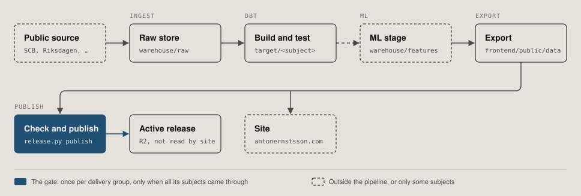

# Pipeline

How a subject gets from its source to the site, and what runs it. This is the only document
that describes orchestration. The definitions themselves are in two files:

- `platform/pipeline.yml`, the registry: one entry per subject with its steps, dbt selectors,
  raw paths, schedule and delivery group.
- `platform/pipeline.py`, the command that reads it. npm scripts, local runs and GitHub Actions
  all call this command.



A subject is fetched to `warehouse/raw`, built and tested by dbt into
`platform/target/<subject>`, passed through an ML stage if it has one, and exported to
`frontend/public/data`. Its delivery group is then checked and published as a versioned
release in R2 (`platform/publish/release.py`, specs in `configs/delivery/`). The site does not
read these releases: it serves the data committed under `frontend/public/data`
([storage-and-serving.md](storage-and-serving.md)). No workflow commits data.

## Running a subject locally

```sh
python platform/pipeline.py list                      # every subject, its group and schedule
python platform/pipeline.py run welfare               # fetch, build, test, export
python platform/pipeline.py run welfare --only dbt    # one phase: ingest, dbt, ml, export, publish
python platform/pipeline.py run symbolic --only dbt:1 # the first dbt step of a subject that has two
python platform/pipeline.py run --all --dry-run       # print every command, check the files exist
python platform/pipeline.py check                     # the four data contracts
python platform/pipeline.py pull welfare              # its raw and feature files from R2
```

The old npm names still work and are one-line aliases: `npm run welfare`, `npm run
parliament:build`, `npm run symbolic:silver`, `npm run concepts`, `npm run data:check`.

Options for `run`:

| Option | Effect |
|---|---|
| `--only a,b` | Only these phases. `dbt:2` picks the second dbt step |
| `--full-refresh` | Sets `PORTFOLIO_FULL_REFRESH=1`: refetch history as well as current data |
| `--ml missing` | Default. Run an ML stage only when its stored output is absent |
| `--ml stale` | Also run it when its inputs changed since the stored run |
| `--ml always` | Rerun every ML stage |
| `--dry-run` | Print the commands; fail if a script, spec or dbt path they name is missing |

Rules the command keeps:

- Each subject builds into its own `platform/target/<subject>`, so one subject's test results
  are never read as another's.
- An export runs only after the subject's ingest, dbt and ML steps all came through and its dbt
  tests passed.
- One failed subject does not stop the others. A subject that `needs` a failed one is skipped.
  The exit code is non-zero if anything failed.
- A group is published once, and only when every subject in it succeeded in the same run.
- Publishing changes the active release in R2. Locally it runs only with `--only publish`, and
  needs the R2 credentials in the environment. In Actions it is part of a normal run.

`pull` and `push` need the R2 credentials too. `push` deletes remote raw files that are gone
locally only for subjects marked `prune: true` (welfare, parliament, taxes).

## Subjects

Times are UTC. "Weekly" is `build-warehouse.yml`, Saturday 21:13, which runs
`pipeline.py run --all`; it is early enough to finish before the daily runs queue behind it on
Sunday morning.

| Subject | Workflow | Schedule | Command | Group | Automatic |
|---|---|---|---|---|---|
| welfare | `refresh-welfare.yml` | daily 04:37 | `run welfare` | public-data | yes |
| parliament | `refresh-welfare.yml` | daily 04:37 | `run parliament` | public-data | yes |
| taxes | `refresh-welfare.yml` | daily 04:37 | `run taxes` | public-data | yes |
| market | `refresh-jobs.yml` | daily 04:23 | `run market` | jobs | yes |
| news | `refresh-news.yml` | daily 05:17 | `run news` | news | yes |
| politics | `build-warehouse.yml` | weekly | `run politics` | baseline | yes |
| ai_act | `build-warehouse.yml` | weekly | `run ai_act` | baseline | yes |
| ai_politics | `build-warehouse.yml` | weekly | `run ai_politics` | baseline | yes |
| symbolic | `build-warehouse.yml` | weekly | `run symbolic` | baseline | yes |
| philosophy | `build-warehouse.yml` | weekly | `run philosophy` | baseline | yes |
| job_ai_governance | `build-warehouse.yml` | weekly | `run job_ai_governance` | baseline | yes |
| concepts | `build-warehouse.yml` | weekly | `run concepts` | baseline | yes |
| cross_domain | `build-warehouse.yml` | weekly | `run cross_domain` | baseline | yes |
| quality | `build-warehouse.yml` | weekly | `run quality` | baseline | yes |
| diva | `refresh-diva.yml` | by hand | `run diva` | diva | one click |
| jobs_analysis | `refresh-job-analysis.yml` | by hand | `run jobs_analysis` | jobs-analysis | one click |
| legacy | none | by hand | `run legacy` | baseline | no |
| politics_check | `ci.yml` | every push | `run politics_check` | none | yes, checks only |

The weekly run also rebuilds the daily subjects, so it stores one complete warehouse in R2
(`warehouse/portfolio.duckdb.gz`, `warehouse/raw/`, `warehouse/features/`).

## What the workflows add

Each workflow checks out the repository, calls `.github/actions/data-setup` and then names
subjects. The shared setup checks the four R2 credentials, installs Python and
`platform/requirements.txt`, optionally the ML dependencies, and restores the stored raw files
(`pipeline.py pull`). All seven data workflows share the concurrency group `data-refresh`, so
two of them never write the same raw manifests or R2 keys at once. `queue: max` lets the runs
waiting for it start in order; by default GitHub keeps only the newest pending run and cancels
the others. Each workflow ends with an `alert` job (`.github/actions/failure-issue`): a failed or
timed-out run opens an issue labelled `data-pipeline-failure`, or comments on the open one, and
the next successful run closes it. A raw prune (`prune: true`) stops without deleting when more
than 5 % of a folder's stored files, or a folder without its local fetch log, would go;
`PRUNE_MAX_DELETE_PCT` raises the limit for an intentional cleanup.

What stays in YAML is the handling of failure, which differs per workflow:

- `refresh-welfare.yml` runs welfare, parliament and taxes as three steps and pushes raw
  checkpoints after each, so a timeout in one source does not lose what the others fetched.
  The group is published only if all three succeeded.
- `refresh-jobs.yml` stores the counts and the stream in R2 before it validates and
  publishes, so the next run starts from them even if validation fails.
- `refresh-news.yml` installs the optional summary SDK when `ANTHROPIC_API_KEY` is set. The
  subject tolerates exit code 2 from the summary step and publishes the headlines alone.
- `build-warehouse.yml` builds every subject, stores the warehouse only if all of them
  built, then exports and publishes each group whose subjects all came through. The quality
  subject ends with the structural gate, after the store.
- `publish-r2.yml` is the bootstrap: it stages every group and activates them together. It
  is not a subject and is run by hand.

After a subject's ingest steps, successful or not, `pipeline.py` records the outcome in
`status/ingestion.json` (`platform/publish/ingest_status.py`): the error if any, the GitHub
run, and per raw source the last fetch, the last content change, files, size and this run's
fetches, changes and failed requests, read from `raw/<source>/_manifest.jsonl`. In Actions the
file is merged into an uncached copy in R2 outside every release; locally it is written to
`frontend/public/data/status/` (git-ignored). The projects page (`#projekt`) reads it. The sources
are the first segments of a subject's `raw` paths; a subject whose fetch log is kept outside
R2 lists it under `sources` (news).

## What a run refetches

The daily runs restore the stored raw files first and fetch only what can have changed. The
rules are in `platform/lib/rawstore.py` and in each source's ingest script.

| Source | Every run | Reused until |
|---|---|---|
| SCB and Folkhälsomyndigheten (PxWeb) | Metadata, and periods from the last two calendar years | Older periods for 90 days, if URL, body, headers and hash match |
| OECD, Försäkringskassan's large tables | Försäkringskassan's metadata | Verified answers for 7 days, so current observations from these two can lag by up to a week |
| ESS | The portal's study and file versions | The same file version and variable selection for 90 days |
| Kolada | Metadata and the block that holds the current years | Complete older blocks for 90 days |
| Skatteverket and HUT | Municipal rates, current amounts, this year's withholding tables | Complete older years and HUT 2021 for 90 days |
| Riksdagen | The two latest sessions | Complete older sessions for 90 days |

A paged year or list is reused only when it has a completion record and every file it names
has the right hash. Starting an update removes the old completion record, so an interrupted
fetch never counts as complete history. `--full-refresh` ignores every age limit.

`refresh-welfare.yml` allows 240 minutes for the job, and 70, 90 and 60 minutes for welfare,
parliament and taxes.

## ML stages

Four subjects have one: ai_politics (similarity to the Act), symbolic, philosophy and concepts.
Each hashes what it is about to embed and records the hash in its `run.json`
(`platform/nlp/text/staleness.py`). With `--ml stale` the stage runs with `--if-stale` and does
nothing when the hash is unchanged. The scheduled weekly run uses `stale`; a run started by hand
defaults to `missing`.

A `run.json` written before the stages recorded a hash counts as stale, so the first `stale`
run recomputes ai_politics, philosophy and concepts once.

## Still manual

| What | Why |
|---|---|
| `platform/legacy/build_politics.py` | Needs three local sources (`--parliament`, `--allegoria`, `--local-corpus`); one is in no repository |
| `run legacy` (`npm run data:build`) | The builders not yet moved into dbt (`build_gold.py`, `build_products.py`, `build_speech_browser.py`); run when their inputs change |
| `run diva`, `run jobs_analysis` | Hours of harvesting or archive imports; started from the Actions tab |
| `symbolic:research`, `symbolic:clean`, `symbolic:experiments`, `symbolic:validity`, `symbolic:review` | Research steps that end in a human review of clusters |
| `politics:parties`, `politics:debates`, `data:parquet`, `data:upload` | Single scripts over local legacy outputs; `upload.py` is the unversioned uploader that preceded `release.py` |
| `publish-r2.yml` | First activation of a bucket, or a full re-stage |

`platform/ingest/jobtech/run_history_pipeline.py` keeps its own dbt build: it discovers which
archive years JobTech has published and passes them to dbt as vars. The registry calls it as
the jobs_analysis ingest step.

## Secrets and variables

All in the `anton-portfolio` environment, except where noted.

| Workflow | Secrets | Variables |
|---|---|---|
| `refresh-welfare.yml`, `refresh-jobs.yml`, `refresh-diva.yml`, `refresh-job-analysis.yml`, `build-warehouse.yml`, `publish-r2.yml` | `R2_ACCOUNT_ID`, `R2_ACCESS_KEY_ID`, `R2_SECRET_ACCESS_KEY` (or `R2_SECRET_ACCESS_KEY_ID`), `R2_BUCKET` | `R2_PUBLIC_BASE` |
| `refresh-news.yml` | the four above, and optionally `ANTHROPIC_API_KEY` | `R2_PUBLIC_BASE` |
| `ci.yml` | repository secrets `R2_ACCOUNT_ID`, `R2_ACCESS_KEY_ID`, `R2_SECRET_ACCESS_KEY`, `R2_BUCKET`, all optional | none |

`R2_PUBLIC_BASE` is `https://data.antonernstsson.com/`. Unset, the catalogue falls back to the
bucket's `r2.dev` address.

## Adding a subject

1. Add its entry to `platform/pipeline.yml`: steps in order, `group`, `schedule`, and `raw` or
   `features` if it stores files in R2.
2. Give its files to a group in `configs/delivery/`, or leave them to `baseline`.
3. `python platform/pipeline.py run <subject> --dry-run`, then run it.

No workflow changes: the weekly run picks up every subject that is not marked `manual`.

## Political workspace export

The parliament subject verifies source-backed formation seeds with
`platform/ingest/riksdagen/formation_ingest.py` before dbt. Its existing exporter now calls
`politics_workspace.py` after writing the parliamentary contracts. The standalone offline
exporter uses committed snapshots; the warehouse path uses tested party roll-call facts.
`parliament/workspace/*` belongs to the public-data release and is excluded from baseline.
Source hashes and bounded coverage are published with the compact index. See
[Political Observatory v2](political-observatory-v2.md) for reproduction and limits.
