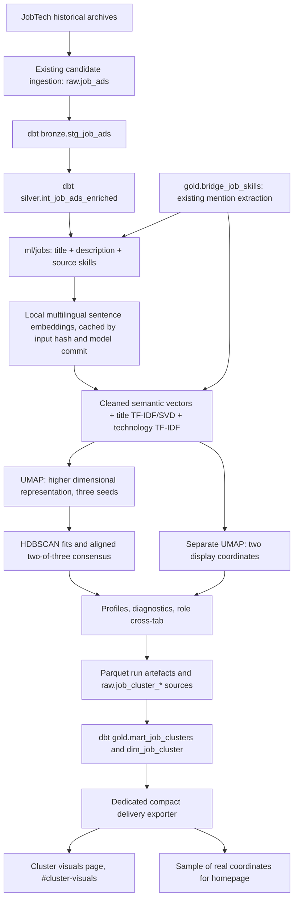

# Job ads: clustering experiments and the MLOps pipeline

Run locally on 2026-10-29 under the shared protocol in [cluster-experiments.md](method.md)
and the criteria in `configs/experiments/jobs.yaml` (frozen 2026-10-29, not edited). Code:
`ml/experiments/jobs.py` (CLI), `jobs_data.py`, `jobs_experiments.py`, `jobs_model.py`, `jobs_mlops.py`;
tests in `ml/experiments/tests/test_jobs_mlops.py`; schedule in `.github/workflows/job-clusters.yml`.
The job assistant's ingest, matching, workflow and D1 are untouched. The clustering only reads the
store, and it is a separate assessment from matching ads against the CV.

**Status (2026-10-30).** The champion is `a35140926c6bf532`: the research settings on v2 text, fitted
on snapshot 1. Champion history (append-only, in `registry.json`):

| When       | Run                        | Action                  | Why                                                                                                   |
| ---------- | -------------------------- | ----------------------- | ----------------------------------------------------------------------------------------------------- |
| 2026-10-29 | `6dcad57bab933c28`         | register:champion       | protocol champion, v1 text                                                                            |
| 2026-10-29 | `214c3c57e1f34498`         | promote                 | clean KBLab K-means 8 passed `jobs.yaml` on v1 text                                                   |
| 2026-10-29 | `6dcad…`, `758e…`, `0a71…` | reject                  | v1 text contained redaction placeholders, or invalid provenance (Deviation)                           |
| 2026-10-29 | `214c…`                    | withdraw (now rejected) | coordinator decision with `Registry.reinstate`: its inputs were invalid                               |
| 2026-10-29 | `a351…`                    | reinstate               | the domain's existing pipeline refitted on corrected v2 text; this is not a promotion on the criteria |
| 2026-10-30 | `20c4dba8403fd63a`         | reject                  | refresh on the latest snapshot failed `jobs-refresh.yaml` on employer dominance (below)               |

## Corpus

The source is the job-assistant store `warehouse/raw/job_assistant/ads.json` (JobTech, Data/IT field, CC0):
2,829 ads published from 2026-07-03 to 2026-10-29, both current and removed. The research clustering
behind `frontend/public/data/jobs/cluster-summary.json` used a different corpus: 35,861 ads from
2022 to 2025. Its numbers are not comparable with the ones here.

| Step                                                                                      | Ads                         |
| ----------------------------------------------------------------------------------------- | --------------------------- |
| In the store                                                                              | 2,829                       |
| Schema failures                                                                           | 0                           |
| Marked `duplicate_of` by the store                                                        | 42 dropped                  |
| Same `duplicate_key` or `content_hash`                                                    | 32 dropped                  |
| Identical text after cleaning                                                             | 0 dropped                   |
| Deduplicated                                                                              | 2,755 (dedup rate 2.6 %)    |
| Snapshot 1 (`035573c07db049ab`): published before 2026-10-26T17:05 (newest 15 % held out) | 2,341, of which 478 removed |
| Selection / evaluation side of snapshot 1                                                 | 1,182 / 1,159               |
| Held-out newer ads                                                                        | 414                         |

**Redaction placeholders.** `platform/publish/job_content.py` replaces e-mail addresses and phone
numbers with `[kontaktuppgift utelämnad]` (1,556 times in the store) and contact names with
`[kontaktperson utelämnad]` (270 times). Text v2 removes both from every variant before anything else
(`jobs_data.MARKERS`).

**Employer boilerplate.** A line of at least 80 characters that appears in at least three ads from the
same employer counts as a template. In snapshot 1, 132 employers have templates (697 lines). 54 % of
ads contain at least one template line, and stripping them removes 12.8 % of all description characters.
On the v1 text, a threshold of two ads gave 67 % and 21 %, and a threshold of five gave 45 % and 10 %.
The `clean` text strips these lines and masks the employer's name ("ARBETSGIVAREN"), including the
name without legal suffixes, a distinctive first word and the genitive s. `raw` keeps the description
as served, minus the placeholders. Both use the ml/jobs `title-description-skills-v1` layout, with
must-have and nice-to-have skills as the skills.

**Split.** `splits.split` on employer (`organisation_number`, else the name) plus the cleaned-text
hash. No group or text appears on both sides; this is checked on every run.

## Champion settings

The champion settings apply the ml/jobs research pipeline to this corpus: raw text, token-chunk mean
`paraphrase-multilingual-MiniLM-L12-v2` at `e8f8c211`, cosine UMAP 10-D with 60 neighbours and
min_dist 0, and HDBSCAN with min_samples 3 and eom selection. Not reproduced: the research run's
title-pattern and technology features (weights .65/.15/.20) and its three-seed consensus. HDBSCAN is
scikit-learn's, not the `hdbscan` package. **min_cluster_size 600 does not transfer.** On the 1,182
selection ads it puts every ad in noise (measured: 0 groups, noise 1.0). The champion therefore uses
the same share of the corpus, 600/35,861 = 0.0167 of the ads fitted, which is about 20 ads here.

## Selection (v2 text, selection side, seeds 0, 1, 2)

The grid has 2 texts × 3 embeddings × 6 clusterings, plus the mcs-600 check: 37 fits in 762 s with a
peak of 2.4 GB. The embeddings are the current MiniLM-L12; `KBLab/sentence-bert-swedish-cased` at
`6b5e83cd`, a Swedish SBERT that was already in the local model cache; and TF-IDF with SVD to 256
dimensions as a non-neural baseline. Multilingual e5 and bge-m3 were not tried, since no new weights
were downloaded. UMAP is fixed at the champion's settings. HDBSCAN uses mcs equal to the research
share (about 20 ads), 10 and 40; K-means uses k = 8, 12 and 16. All 37 results are in
`warehouse/features/experiments/jobs/selection/035573c07db049ab.json`. A selection:

| Fit                                          | Groups | Noise | Largest | Seed ARI | Silhouette (rep.) | Employer top share |
| -------------------------------------------- | ------ | ----- | ------- | -------- | ----------------- | ------------------ |
| raw MiniLM HDBSCAN research share (champion) | 2      | 0.00  | 0.96    | 0.99     | −0.01             | 0.12               |
| raw MiniLM HDBSCAN mcs 10                    | 32     | 0.32  | 0.06    | 0.88     | 0.11              | 0.38               |
| raw TF-IDF HDBSCAN mcs 10                    | 17     | 0.20  | 0.33    | 0.96     | 0.31              | 0.41               |
| raw TF-IDF K-means 12                        | 12     | 0     | 0.24    | 0.89     | 0.15              | 0.29               |
| clean MiniLM HDBSCAN mcs 10                  | 34     | 0.38  | 0.04    | 0.89     | 0.09              | 0.27               |
| clean MiniLM HDBSCAN mcs 40                  | 6      | 0.26  | 0.21    | 0.85     | 0.08              | 0.13               |
| clean KBLab K-means 8                        | 8      | 0     | 0.25    | 0.75     | 0.08              | 0.14               |
| clean KBLab K-means 12                       | 12     | 0     | 0.14    | 0.79     | 0.07              | 0.15               |

What selection showed:

- Cleaning lowers employer dominance for every embedding and clustering; raw MiniLM K-means 8 has
  0.20, clean 0.13. Raw TF-IDF has the best silhouette and stability, largely because templates make
  one employer's ads alike.
- Removing the placeholders lowered clean KBLab K-means 8's seed ARI from 0.94 (v1) to 0.75. The
  placeholder tokens had made ads more alike and so inflated stability. On v1 this run was picked
  and promoted; on v2 it was not picked.
- The champion settings are unstable on half the corpus. With about 20 ads per group, raw MiniLM
  finds 2 groups on the selection side, while the evaluation side gives 13 (below).

The pick rule (`PICK_RULE`) was fixed before the first final run. Fits that meet the absolute criteria
come first; within them, rank by seed ARI and then representation silhouette. Take the best HDBSCAN
fit, the best K-means fit, and the best fit whose text or embedding differs from both. On v2 the
candidates were `raw TF-IDF HDBSCAN mcs 10`, `raw TF-IDF K-means 12` and `clean MiniLM HDBSCAN mcs 10`.

## Final evaluation (v2 text, evaluation side, 1,159 ads, seeds 10–14)

| Run                                        | Groups | Noise | Largest | Seed ARI (min) | Silhouette rep. | Employer top share (null p95) | Occupation AMI | Decision                           |
| ------------------------------------------ | ------ | ----- | ------- | -------------- | --------------- | ----------------------------- | -------------- | ---------------------------------- |
| `a35140926c6bf532` champion settings       | 13     | 0.26  | 0.12    | 0.92 (0.85)    | 0.065           | 0.18 (0.10)                   | 0.30           | reference, registered as candidate |
| `272c386613bb3d71` raw TF-IDF HDBSCAN 10   | 35     | 0.19  | 0.20    | 0.96 (0.94)    | 0.283           | 0.55 (0.13)                   | 0.18           | rejected: employer dominance       |
| `8a2ac851197b0485` raw TF-IDF K-means 12   | 12     | 0     | 0.20    | 0.86 (0.80)    | 0.162           | 0.31 (0.09)                   | 0.15           | rejected: employer dominance       |
| `62fa1938d9eb0616` clean MiniLM HDBSCAN 10 | 22     | 0.24  | 0.09    | 0.89 (0.83)    | 0.036           | 0.18 (0.11)                   | 0.33           | rejected: no measured gain         |

All four saved models reproduce their measured fit (artifact label ARI 1.0).

**Over time.** Each model is fitted on snapshot 1 and assigns the 414 newer ads. For comparison, the
same pipeline is refitted on old and new ads together. Agreement is the ARI on the new ads, with noise
excluded.

| Run               | Newer ads assigned | Refit covers | Agreement ARI with refit |
| ----------------- | ------------------ | ------------ | ------------------------ |
| champion settings | 0.52               | 0.62         | 0.83                     |
| TF-IDF HDBSCAN 10 | 0.38               | 0.80         | 0.93                     |
| TF-IDF K-means 12 | 0.87               | 1.00         | 0.74                     |
| MiniLM HDBSCAN 10 | 0.42               | 0.67         | 0.83                     |

**Trade-offs by criterion.** Stability and separation: the TF-IDF runs lead, but their groups follow
the employer (top share 0.31 and 0.55, against a null of about 0.1). Employer dominance: the champion
settings and clean MiniLM HDBSCAN tie at 0.18. Specificity: HDBSCAN gives the finest task groups, such
as network engineers (Cisco, routing), Java/Spring, data/SQL and helpdesk, with 24 to 26 % noise.
Coverage of newer ads: TF-IDF K-means is highest, but it carries employer structure.

**Decision.** No candidate passed `jobs.yaml`. Both TF-IDF runs broke the 0.02 tolerance on employer
dominance. Clean MiniLM HDBSCAN 10 met every floor but showed no measured gain: seed ARI 0.89 vs 0.92,
silhouette 0.036 vs 0.065, noise 0.24 vs 0.26. Nothing was promoted.

The groups of the v2 champion-settings run, as generated c-TF-IDF terms (unreviewed). The stop list is
the shared Swedish one plus `AD_FILLER`, fixed after reading the first export's terms.

| Group | Ads | Terms                                                              | Most common JobTech occupation (share) |
| ----- | --- | ------------------------------------------------------------------ | -------------------------------------- |
| 0     | 27  | linux utveckling relevant kompetens säkerhet jobba polisen         | Systemadministratör (0.33)             |
| 1     | 125 | support microsoft ärenden användare problem tekniker felsökning    | Helpdesktekniker (0.42)                |
| 2     | 22  | cisco nätverk nätverkstekniker routing switching infrastruktur     | Nätverkstekniker (0.82)                |
| 3     | 74  | test testing testning tester elektronik mjukvara verifiering       | Mjukvarutestare (0.16)                 |
| 4     | 49  | verifiering safety tekniskt komplexa dokumentation projekt         | Systemutvecklare (0.16)                |
| 5     | 29  | data sql learning utveckla engineer medical qlik datamodellering   | Data scientist (0.17)                  |
| 6     | 34  | business architecture data enterprise solutions teams agenter      | Mjukvaruutvecklare (0.29)              |
| 7     | 136 | minst leda arbetssätt behov skapa förmåga utveckling               | Projektledare IT (0.24)                |
| 8     | 121 | förmåga vid säkerhet anställning arbetsuppgifter enligt personliga | IT-säkerhetsanalytiker (0.10)          |
| 9     | 120 | software embedded development mjukvara linux systems               | Mjukvaruutvecklare (0.44)              |
| 10    | 72  | cloud azure net backend api aws infrastructure                     | Systemutvecklare (0.21)                |
| 11    | 21  | backend net utvecklare technical produkt code                      | Mjukvaruutvecklare (0.19)              |
| 12    | 31  | java spring backend development services kubernetes boot           | Backend-utvecklare (0.32)              |

Group 8 follows public-sector application wording (anställning, enligt, personliga) more than a task.
"polisen" and "fouredge" are employer or client names that masking did not cover.

## Deviation (2026-10-29)

Both changes were made after the first final evaluation, at the coordinator's request.

1. **Redaction placeholders removed: text v1 to v2.** The first run embedded
   `[kontaktuppgift utelämnad]` and `[kontaktperson utelämnad]`, and one champion group was partly held
   together by them. Text versions `…ja-raw-v2` and `…ja-template-strip-mask-v2` remove them. The new
   text hashes start new embedding caches. Then prepare, select, final and export were rerun. The v1
   runs were not deleted: `6dcad57bab933c28`, `758e40d952640cf8` (both candidates) were rejected with
   "text contained redaction marker; superseded by <v2 run>". `2314cb95edec26ea` and `6bc205b6510bf816`
   were already rejected and are unchanged. No v2 candidate passed, so `214c3c57e1f34498` first stayed
   champion. The coordinator then withdrew it and reinstated the v2 research-settings run `a351…`
   (`Registry.reinstate`, see Status). `ex.vectors` now refuses a pipeline whose
   recorded text version differs from the current one. The first v2 retrain, run before that check,
   reused the v1 champion's pipeline record on v2 text (`0a71cb3cfe72bcb4`). It was rejected as invalid.
2. **Refresh rule: `configs/experiments/jobs-refresh.yaml`** (frozen 2026-10-29). `jobs.yaml` demands
   a measured gain, so a plain refit of the champion on newer data could never pass (the v1 retrain
   `6bc205b6510bf816` failed on exactly that). The refresh file keeps the four floors plus "employer
   dominance not worse (0.02)" and "separation not worse (0.03)", and has no gain requirement.
   `jobs_mlops.rule_file` applies it only when the candidate's text, embedding, representation,
   reduction and clustering equal the reference's and only the dataset version differs. Every other
   comparison uses `jobs.yaml`. Each acceptance report records `criteria_file` and `criteria_sha256`.
   Both branches are tested. On real data its first decision was the rejection of `20c4…` (employer
   dominance, 2026-10-30).

## MLOps design

| Need                                  | Implementation                                                                                                                                                                                                                                                                                                                                                                    |
| ------------------------------------- | --------------------------------------------------------------------------------------------------------------------------------------------------------------------------------------------------------------------------------------------------------------------------------------------------------------------------------------------------------------------------------- |
| Incremental ingest                    | `jobs_data.diff`: new ids, changed `content_hash`, newly removed and missing ads since the model's snapshot                                                                                                                                                                                                                                                                       |
| Versioned cleaning, dedup, validation | The text versions and template thresholds are part of every text hash. A missing, empty, non-JSON or non-list store, no valid ad, or more than 5 % schema failures raises `InputError`. A model on an older text version raises `ValueError` instead of embedding new text under an old label                                                                                     |
| Embedding cache                       | `ml.experiments.embed`, keyed by text hash, model revision and text version + pooling. A change in model or preprocessing starts a new cache folder                                                                                                                                                                                                                               |
| Dataset snapshot                      | `snapshots/<dataset_version>.json` holds ids, hashes, dates and the removed flag, with no text. The text table is `warehouse/ml/experiments/jobs/<version>.parquet` (local only)                                                                                                                                                                                                  |
| Model artifact                        | `models/<run_id>/model.joblib` holds the pipeline (text version and cleaning parameters, embedding and revision or the fitted TF-IDF/SVD, the fitted UMAP, training labels, centroids and radii in the reduced space, centroids in the representation space). `manifest.json` adds run_id, dataset_version, snapshot_version, train ids and sha256. `load` refuses tampered files |
| Registry                              | `Registry('jobs')` with candidate, champion and rejected. Promotion needs a passed `accept.check` (`jobs.yaml`, or `jobs-refresh.yaml` for a refresh); `rollback`                                                                                                                                                                                                                 |
| Export                                | `export.run_file` and `export.index`. The run file names `run_id`, `dataset_version`, the acceptance report and the status. No separate assignments file is published                                                                                                                                                                                                             |
| Assignment between retrains           | Nearest centroid in the saved model's reduced space (`umap.transform`), accepted only within that group's 95th-percentile training radius. Otherwise the label is −1, "fits no group"                                                                                                                                                                                             |
| Version diff                          | Jaccard overlap of the ads both models trained on, plus centroid cosine when the embeddings match. It reports matched, split and merged groups, and links below 0.3 as uncertain (`diffs/<old>__<new>.json`)                                                                                                                                                                      |
| Monitoring                            | `monitor/<kind>-<snapshot>-<model>.json`. Flags set `action: investigate` and never promote                                                                                                                                                                                                                                                                                       |

All files except the text table sit under `warehouse/features/experiments/jobs/` and the shared
registry and embedding folders, so `warehouse_store.py push --only features --path experiments` keeps them.

**Monitor fields:** volume (store ads, snapshot ads, new, changed, removed, missing), dedup rate,
schema failures, template statistics, drift (mean cosine of training and new ads to the training
centre, and the shift between them), assignment (ads, assigned and abstained share, the training
abstain rate, ads per group), training noise share, coverage, group sizes, resources, flags. A flag is
raised for schema failures, for abstentions more than 0.10 above the training rate, and for a cosine
shift above 0.05. The thresholds are set by hand and not yet calibrated.

## Second-snapshot cycle with the reinstated champion (2026-10-30)

The model artifact `models/a35140926c6bf532/` comes from `final`. It holds text v2 with the cleaning
parameters, MiniLM-L12 at `e8f8c211`, the fitted UMAP, training labels, centroids and 95 % radii, and
a manifest with the sha256 (snapshot `035573c07db049ab`, dataset `5fdeddb1ab2a6f40`, 1,159 ads).

- Assign (snapshot `8a1c96974181fe18`, 2,755 ads): 414 new, 0 changed, 0 removed. Changes cannot
  be simulated, because the store keeps only current text. 51.7 % of the new ads were assigned and
  48.3 % abstained ("fits no group"), against a training abstain rate of 18.8 %. HDBSCAN leaves 25.7 %
  of training ads in noise, and the radius rule abstains on those. The abstention flag was raised.
  Drift shift was 0.012, below the 0.05 flag. New ads went mostly to group 7 (project leads, 55),
  group 8 (public-sector security wording, 41), group 1 (support, 39) and group 9 (embedded, 35); group
  11 got none. The file is `monitor/assign-8a1c96974181fe18-a35140926c6bf532.json`.
- Retrain on the evaluation side of the latest snapshot (1,364 ads). The pipeline is identical, so
  `jobs-refresh.yaml` judged it (recorded as `criteria_file`). The refit `20c4dba8403fd63a` gave 16 groups,
  noise 0.243, largest 0.095, seed ARI 0.913, separation 0.065 and employer top share 0.214. It met the
  floors and the separation rule, but failed "employer dominance not worse" (0.214 vs 0.179, tolerance
  0.02). It was **rejected**, and the champion stays.
- Version diff (`diffs/a35140926c6bf532__20c4dba8403fd63a.json`, 1,019 shared training ads):
  - 9 of 13 old groups matched one to one.
  - Old group 7 (project leads) split into new groups 12 and 13 (Jaccard 0.32 and 0.45, centroid cosine 0.98).
  - No merges.
  - Uncertain links (best Jaccard below 0.3): old 0, 4 and 12; new 1, 3, 8, 10 and 14.
- Export: run files for the five v2 runs (champion, three rejected candidates, the rejected
  refresh), then `export.index()`. The v1 run files stay, with status rejected.
- Rollback drill on a copy of the registry, with the new core behaviour (rejected runs skipped):
  "no earlier champion to restore", because every earlier champion is now rejected. The real registry
  is unchanged.
- The invalid v2 monitor file from the v1 model on v2 text (`0a71…`) was moved to `monitor/invalid/`
  with a note.

Measured: assign 29.5 s at 1.06 GB peak, retrain 39.5 s at 1.17 GB, export 24 s at 1.35 GB (one CPU
process; embeddings came from the cache).

## Earlier local runs (2026-10-29)

**v1** (`prepare --hold-out-newest 0.15`, then select, final, export, assign, retrain, and rollback on a copy):

- final promoted clean KBLab K-means 8 (`214c…`).
- assign: 414 new ads, 74 % assigned against a training abstain rate of 5.3 %; the abstention flag
  was raised.
- retrain: rejected on "a measured gain".
- These numbers are superseded, as described under Deviation.

**v2:**

- select and final as above; nothing passed.
- The assign and refit in that drill used the v1 model on v2 text (`0a71…`). They are invalid and
  were rejected or moved, as above.

**Resources** (`tmp/jobs/resources.json` for v2 and `resources-v1.json`, measured with `runtime.measure`;
12 CPUs, GTX 1660 for embeddings):

| Step                                                        | Wall time v1 / v2     | Peak RSS v1 / v2 |
| ----------------------------------------------------------- | --------------------- | ---------------- |
| Sample check: 200 ads, three embeddings plus one 3-seed fit | 82 s / –              | 1.7 GB           |
| select (37 fits)                                            | 710 s / 762 s         | 2.8 / 2.4 GB     |
| final (4 runs × 5 seeds, artefacts, temporal refits)        | 329 s / 231 s         | 3.2 / 3.1 GB     |
| export                                                      | 47 s / 19 s           | 1.2 / 2.5 GB     |
| assign / retrain                                            | 4.5 / 41 s; 29 / 99 s | ≤ 3.0 GB         |

The heavy work took about 20 minutes per pass inside `runtime.heavy`; the first pass also waited
about 45 minutes for the lock.

## First runs in GitHub Actions (2026-10-30)

These ran on a standard Ubuntu runner, CPU only, from main after #196 and #197.

- The first dispatch of `heavy-compute.yml` (job `experiments`, `philosophy select`, run 40993146600)
  stopped on `ModuleNotFoundError: psutil`, because the ML lock lacked it. #197 added it. The second
  dispatch (run 40994244944) pulled 327 files from R2 and found every fit already checkpointed.
  Its run step took 3 seconds and pushed 2 files back. This shows that resuming from R2 works;
  it does not measure CPU fitting time.
- `job-clusters.yml` `assign` (run 40994537885) read the live store. Against the champion's snapshot
  it found 97 changed and 42 removed ads. It gave 44.4 % of new and changed ads "fits no group",
  against 18.8 % at training, and raised the investigation flag. The step took 66.7 s at a 2.15 GB
  peak, including the CPU embedding of those ads.
- `job-clusters.yml` `retrain` (run 40994561492) fitted candidate `8fc83877c0593b28` on the latest
  snapshot. `jobs-refresh.yaml` judged it, and it was rejected on employer dominance. Nothing was
  promoted. The assign part of that run took 13.2 s at a 0.72 GB peak because the embeddings were
  cached.

The full selection grid (37 fits) then ran from scratch in run 41014204044. It took 53 min 43 s on
a newer snapshot of 2,843 ads, so its picks differ from the selection above. Peak memory was not
recorded. See [Runner measurements](method.md#runner-measurements-2026-10-30).

## Runner drill: over time and rollback (2026-10-30)

Actions run 41091714598 ran `jobs select,final,rollback repro:drill-jobs --hold-out-newest 0.15
--reason runner-rollback-drill` on a standard Ubuntu runner (CPU). Everything went to
`features/experiments/repro/drill-jobs/`; the stored registry did not change. The store had 2,981
ads (dataset `62223f4f601cb39e`); 2,896 after deduplication, and 2,461 after holding out the newest 15 %. The 435 newer ads
were assigned afterwards. Splits are by employer, as before.

| Step     | Time        | Peak memory |
| -------- | ----------- | ----------- |
| prepare  | 4 s         | 0.42 GB     |
| select   | 54 min 10 s | 3.49 GB     |
| final    | 38 min 42 s | 4.61 GB     |
| rollback | 1 s         | 0.23 GB     |

| Run (evaluation side)       | Status after drill  | Employer top share (null p95) | Newer ads assigned | Refit covers | Agreement ARI |
| --------------------------- | ------------------- | ----------------------------- | ------------------ | ------------ | ------------- |
| champion settings refitted  | champion (restored) | 0.189 (0.100)                 | 0.55               | 0.77         | 0.77          |
| clean MiniLM-L12 HDBSCAN 10 | rejected (demoted)  | 0.196 (0.111)                 | 0.34               | 0.70         | 0.84          |
| raw TF-IDF K-means 8        | rejected            | 0.223 (0.082)                 | 0.95               | 1.00         | 0.60          |
| clean KBLab HDBSCAN 10      | candidate (passed)  | 0.200 (0.119)                 | 0.41               | 0.66         | 0.81          |

Two candidates passed the frozen criteria and `final` promoted MiniLM HDBSCAN 10 (highest seed
ARI). TF-IDF K-means 8 failed "employer dominance not worse". The `rollback` step then demoted the
promoted run and restored the refitted champion, with the drill reason in the history. In every
run the employer top share stays above its null p95, so employer templates still shape the groups.
Over time, the HDBSCAN runs leave more newer ads unassigned but agree better with a refit; K-means
assigns almost all but agrees least. This is a drill on a newer snapshot, not a reproduction, and
it changes no stored decision.

## Runbook

```bash
ml/.venv/Scripts/python.exe -m ml.experiments.jobs prepare            # full store; --hold-out-newest 0.15 for the drill
ml/.venv/Scripts/python.exe -m ml.experiments.jobs select --deadline-minutes 120
ml/.venv/Scripts/python.exe -m ml.experiments.jobs final  --deadline-minutes 120   # registers, decides, promotes a passed candidate
ml/.venv/Scripts/python.exe -m ml.experiments.jobs export
ml/.venv/Scripts/python.exe -m ml.experiments.jobs assign             # new and changed ads -> group or -1, monitor file
ml/.venv/Scripts/python.exe -m ml.experiments.jobs monitor            # latest monitor file
ml/.venv/Scripts/python.exe -m ml.experiments.jobs retrain [--promote]
ml/.venv/Scripts/python.exe -m ml.experiments.jobs promote --run-id <id> --reason "..."
ml/.venv/Scripts/python.exe -m ml.experiments.jobs rollback --reason "..." [--copy-to tmp/registry-copy]
```

`select` and `final` checkpoint each fit under `checkpoints/` and resume after an interruption.

**Schedule.** `job-clusters.yml` runs every Monday at 04:41 UTC, and can also be started by hand. It
pulls `features/experiments` and `raw/job_assistant`, runs `assign` and `monitor`, and pushes
`features/experiments` back, after a failure too. Started by hand with `retrain`, it also refits a
candidate; it never passes `--promote`. A person reads the acceptance report and the diff, then runs
`promote`. It shares the `cluster-jobs-experiments` concurrency group with `heavy-compute.yml`.

**Tested** (`test_jobs_mlops.py`, 11 tests, about 5 s): missing, empty, non-JSON, wrong-shape and
mostly invalid input; dedup by duplicate_of, duplicate_key and hash; template stripping and masking;
placeholders never reach embedded text, and old-version pipelines are refused; leak-free split; new,
changed and removed detection; cache invalidation on model and preprocessing change; resume after an
interruption; abstention; model ↔ dataset ↔ export linkage and the tamper check; rejection, promotion
and rollback on a copy; the refresh rule and the `jobs.yaml` branch; monitor flags; version diff.
**Run in Actions:** assign, retrain and select (see above). **Untested:** `final` on a runner.

## Limitations

- About three months of ads from one occupation field. The groups describe this window only.
- The champion was reinstated by a coordinator decision (`Registry.reinstate`), not by passing
  `jobs.yaml`. No pipeline compared on v2 text has beaten it.
- With HDBSCAN, assignment abstains on about a fifth of training ads (noise and the radius tail).
  Abstention is compared with that training rate, not with zero.
- No rollback target exists: every earlier champion is rejected.
- The champion settings reproduce only the research pipeline's semantic text, at a scaled
  min_cluster_size. On the selection side they gave 2 groups, on the evaluation side 13.
- The assignment radius is a 95th-percentile rule. HDBSCAN's own `approximate_predict` was not used
  (scikit-learn's HDBSCAN has none).
- Template stripping is measured on the whole snapshot before the split. It uses no labels, and
  employers never sit on both sides.
- Masking covers the advertising employer only. Client names remain, and the headline in published
  examples is not masked.
- Group terms are generated and unreviewed; `AD_FILLER` was chosen after one look at the terms.
- The drift and abstention thresholds are set by hand.

## The 2022–2025 research corpus

The sections below cover the research clustering behind `frontend/public/data/jobs/cluster-summary.json`, a different corpus from the one above.

## Semantic structure of selected Swedish tech advertisements

The question is whether natural groups in advertisement language match the four existing
title-based families: Data Engineer, Analytics Engineer, Data Scientist and Software Developer.
This is **not** a model of the entire Swedish labour market, a count of hires, or a validated
occupational taxonomy. The all-occupation market report was withdrawn on 2026-10-21; its data
feeds `#what-does-it-even-mean`.

### Architecture and ownership



`ml/jobs/` extends the existing separate ML environment. Ingestion, role classification,
skill extraction and dbt remain in `platform/`; React consumes delivery. Python never
creates gold marts. The three `raw.job_cluster_*` tables are the ML-to-dbt boundary, imported
transactionally only after all coordinates and probabilities validate.

Cluster dbt models and their tests are opt-in through `job_clusters_enabled`. An ordinary
portfolio build does not require model weights or an ML warehouse. Existing reports and
data exports are not regenerated or replaced by this analysis.

### Selection and provenance

The loader queries `silver.int_job_ads_enriched`, retains precisely the four existing role
families and excludes empty descriptions. It uses `gold.bridge_job_skills` without copying
the extraction regexes. Role, seniority, publication year, region and employment type are
metadata and never enter the embedding input. Required skill labels supplied by JobTech
are included in addition to the existing detected mentions.

The published run (`efd2e318dc1621b2`) reads the **official 2022–2025 archives**, loaded with
the existing ingestion: 3,392,438 raw records and 87,287 retained candidates. dbt
classification and nonempty descriptions leave 35,861 analysis advertisements with 26,104
distinct input texts. The first run used the 2025 archive alone (6,123 ads). The candidate
universe is broader than the classified universe because candidate retention also uses
occupation matches and dbt applies title exclusions.

Archives: `https://data.arbetsformedlingen.se/annonser/historiska/<year>.jsonl.zip` for 2022,
2023, 2024 and 2025; each month's hash is in the coverage ledger.

SHA-256 of the 2025 archive: `43499d2835b607f47e9641443e160bfcab26816c4f04fa17e87bb52b48ce79c6`

The archive includes publication-date spillover. A publication-year filter outside 2025
does **not** imply a complete additional annual archive. The delivery manifest includes
the archive coverage ledger, source hashes and whether a hash sample was requested.
Earlier archives can be appended with the existing ingestion and the same analysis rerun.
No fixture data can pass the analysis loader.

### Embeddings and reproducibility

Default model: `sentence-transformers/paraphrase-multilingual-MiniLM-L12-v2`.
It is a local multilingual model producing 384-dimensional sentence/paragraph embeddings;
its relatively small size and multilingual training make it a practical Swedish/English
baseline. See the [model card](https://huggingface.co/sentence-transformers/paraphrase-multilingual-MiniLM-L12-v2)
and [multilingual model documentation](https://github.com/huggingface/sentence-transformers/blob/main/docs/sentence_transformer/pretrained_models.md).
The rule for model services, from [workers-ai.md](../../products/allegora/workers-ai.md):
"Endast öppen, publicerad data skickas till Workers AI. Besökarens text loggas aldrig och sparas inte."

The model has a short token window. The implementation divides each complete semantic input
into token-sized chunks, embeds them locally, computes a token-weighted mean and normalises
that vector. This avoids silently retaining only the beginning of a long advertisement.
Mean pooling can still overemphasise company boilerplate and dilute individual requirements;
the model is a baseline, not a model validated specifically on Swedish recruitment text.

Input whitespace and skill order are normalised; languages and spelling are retained.
SHA-256 covers the text representation version and exact normalised input. The model's
Hub commit is resolved before cache lookup. Cache identity includes that commit and the
chunking representation. One vector is stored per distinct text; duplicate ads reuse it.

`warehouse/ml/jobs/embeddings-<identity>.parquet` stores job ID, text hash, model/revision,
representation, vector and timestamp. Batch checkpoints are atomically replaced, so an
interrupted run resumes. Warehouse, weights and source text remain gitignored.

Each run stores assignments, profiles and `report.json` under `warehouse/ml/jobs/runs/`.
Its identity incorporates text, delivered metadata, parameters, dependency versions,
implementation hash and coverage. The report records the resolved model commit, seed,
dependency versions, cache reuse and diagnostics. Fixed seed is reproducible within that
environment; different library versions or hardware can change the fitted space and IDs.
Cluster IDs are run-specific, not persistent occupational identifiers.

### UMAP and HDBSCAN

The current defaults, selected after feature ablations and consensus checks, are cosine
UMAP with 60 neighbours, 10 dimensions and `min_dist=0` for
clustering, and an independent 2D UMAP with `min_dist=.08` for display. HDBSCAN operates on
the **10-dimensional space**, using Euclidean distance there, `min_cluster_size=600` (100 in
the 2025-only run; six times the ads, six times the minimum; the CLI default is still 100,
so pass `--min-cluster-size 600`),
`min_samples=3`, and eom selection. Aligned fits at seeds 42/43/44 assign a group only
when two agree. Noise (`cluster_id=-1`) is retained. The input combines cleaned semantic
text, title patterns and detected technology mentions with weights .65/.15/.20. See
[feature and ensemble findings](#feature-engineering-and-clustering-ensemble-4-october-2026) for the 192-fit ablations,
disjoint-seed check, limitations and exact reproduction commands. The earlier 417-candidate
embedding-only search remains available as a baseline with explicit parameters.
Each of these settings is exposed by the command-line interface.

See [UMAP's clustering guide](https://umap-learn.readthedocs.io/en/latest/clustering.html).
UMAP can alter density and manufacture apparent separation. Display axes have no
interpretable units, and global geometry is not a calibrated measure of similarity or
causality. Year filtering hides points in the same fitted space; it never refits UMAP.

### Profiles and evaluation

Profiles contain counts, shares, role cross-tabs, title frequencies, seniority shares,
regions, years, smoothed skill lift and high-membership representative advertisements.
The dbt cluster dimension joins existing employer metadata to show the five largest
employer shares. A majority from one employer triggers an explicit warning in the profile.
Skill lift is compared against the entire analysis dataset, with minimum support and a
minimum lift of 1.5 and 15% within-group support for labels. Weak skill/title differentiation is labelled as a mixed
tech group instead of suggesting a precise occupation. Skills are mentions, including
optional or negated mentions; seniority remains the existing title-rule approximation.
For single fits, membership describes the HDBSCAN fit, not the truth of the label.
For consensus, the delivered support is the agreeing vote fraction (2/3 or 1, zero for noise).
Neither is a calibrated occupational-label probability.

Diagnostics include cluster counts and sizes, noise share, mean membership, silhouette
in both the clustering representation and the original embeddings (cosine), excluding noise,
trustworthiness of the display against
cosine embedding neighbours, and adjusted Rand index/cross-tabs against existing roles.
The fused-feature map also reports trustworthiness against its own feature neighbours;
the original-text diagnostic remains separate.
Silhouette is null when not defined. Expensive pairwise diagnostics use a deterministic
sample capped at 1,500 rows, and the sample size is reported.

`--compare` reruns two alternatives: half the neighbour count and half the minimum cluster
size. These are sensitivity checks, not an automatic search for the prettiest picture.
The headline result and parameter comparisons are recorded in delivery. The measured results are in the generated run
report, [the parameter sweep](#job-clustering-parameter-sweep-4-october-2026) and [the feature
ensemble](#feature-engineering-and-clustering-ensemble-4-october-2026).

Repeated advertisements are distinct records, so recruitment templates and employer
language can create dense groups. Ad distribution is also highly imbalanced across roles;
Analytics Engineer has little support in this archive. A future employer-grouped and
template-deduplicated sensitivity study would help distinguish technology from wording.
The previous embedding-only sweep configuration was also checked at seeds 43 and 44. Agreement is reported
both for all rows including noise and for rows assigned by both fits; the latter covers
only 42.6–45.9% of the full dataset and must not be presented as stability of every ad.
The current ensemble's disjoint seed check covers an 80.94% common assigned core;
see [ensemble findings](#feature-engineering-and-clustering-ensemble-4-october-2026) for both all-row and core agreement.
Cross-year or employer-grouped stability remains untested.

### Parameter sweep
Profiles and seed review led to choosing the 25-group leaf configuration instead of the
highest-ranked 84-group fragmentation. See [sweep findings](#job-clustering-parameter-sweep-4-october-2026) and
the [complete candidate table](job-clustering-sweep.csv). `--review <candidate.json>` checks
two additional seeds and saves profiles; `--sweep-candidate <candidate.json>` in the pipeline
requires matching corpus, metadata, model, parameters and dependency versions, then verifies
the recomputed assignments against the reviewed candidate before writing raw tables.

### Rerun on Windows

Run from the repository root. Install the existing platform and ML requirements in their
respective environments if needed. No new web framework or embedding API is required.

```powershell
# Existing ingestion, using any desired complete historical years.
python platform/ingest/jobtech/ingest_history.py --years 2025 `
  --database warehouse/jobtech/history.duckdb --directory warehouse/raw/jobtech/history

$env:PORTFOLIO_DB = "$PWD/warehouse/jobtech/history.duckdb"
python -m dbt.cli.main seed --project-dir platform --profiles-dir platform `
  --select role_patterns role_classification_patterns technology_patterns
python -m dbt.cli.main build --project-dir platform --profiles-dir platform --select tag:jobs

ml/.venv/Scripts/python.exe -m ml.jobs.feature_experiment
ml/.venv/Scripts/python.exe -m ml.jobs.feature_experiment --review `
  warehouse/ml/jobs/feature-experiments/ff2856dc431d0f8c/balanced-n60-d10-c100-ms3-eom.json
ml/.venv/Scripts/python.exe -m ml.jobs.feature_experiment --consensus-check `
  warehouse/ml/jobs/feature-experiments/ff2856dc431d0f8c/balanced-n60-d10-c100-ms3-eom.json
ml/.venv/Scripts/python.exe -m ml.jobs.pipeline `
  --feature-candidate warehouse/ml/jobs/feature-experiments/ff2856dc431d0f8c/balanced-n60-d10-c100-ms3-eom.json `
  --revision e8f8c211226b894fcb81acc59f3b34ba3efd5f42

python -m dbt.cli.main build --project-dir platform --profiles-dir platform `
  --vars '{job_clusters_enabled: true}' --select tag:job_clusters
python platform/publish/export_job_clusters.py

ml/.venv/Scripts/python.exe -m pytest ml/jobs/tests -q
npx playwright test --config frontend/playwright.config.ts frontend/tests/clusters.spec.ts
npm run build
```

`--database` and `ML_JOBS_DB` override the ML/export database. `--model` and `--revision`
choose weights; `--neighbors`, `--dimensions`, `--cluster-min-dist`, `--visual-min-dist`,
`--min-cluster-size`, `--min-samples`, `--selection-method` and `--seed` expose parameters.
`--limit` requests an explicit deterministic SHA-256 sample, marked as sampled in delivery.
The published run uses all 35,861 eligible rows and no limit. It gives 10 groups, 16.7 % of the ads in none, and the largest group holds 27.6 %. The feature ablations and the parameter sweep were run on the 2025 corpus; they have not been repeated on 2022–2025, so this run applies the chosen settings with `--min-cluster-size 600` and no `--feature-candidate` (the candidate above holds `min_cluster_size` 100 and must match the run's parameters). A new corpus or dependency
version produces a different sweep directory; use its printed path instead of this run's path.

The exporter writes immutable JSON point shards of 5,000 rows, an aggregate manifest and
a 1,500-point real-coordinate homepage sample. It verifies run consistency and reconciles
row counts before export. Each point includes title and skill mentions for interaction,
never descriptions or embeddings. `#cluster-visuals` loads the point shards; the job map
(`frontend/src/home/JobsMap.tsx`) and the cluster gallery load only `jobs/preview-detail.json`.

Cluster visuals draws the points coloured by cluster, with a legend of the clusters
(`frontend/src/clusters/ClusterScatter.tsx`); `frontend/tests/clusters.spec.ts` covers it.

## Job clustering parameter sweep, 4 October 2026

The original five-cluster fit put 84.99% of the 6,123 advertisements in one mixed group.
The selected replacement produces **25 groups**, with the largest containing **287 ads
(4.69%)**. It assigns 3,190 ads and leaves **2,933 (47.90%)** as noise. This improves the
resolution of identifiable groups while reducing coverage; it does not establish a clean
occupational taxonomy for the whole dataset.

### Search and selection

The same corpus, 384D cached multilingual embeddings, model commit and random seed 42
were used for all **417 candidates**. No advertisements were removed, translated or
re-embedded, and no embeddings contain the title-rule role labels.

Grid: UMAP neighbours 10/30/60 × dimensions 5/15 × minimum distance 0/.1;
HDBSCAN minimum cluster size 20/30/60/100 × minimum samples 3/5/10/20 × eom/leaf.
The initial UMAP 30/15/.05 representation was also searched, and its original
HDBSCAN 50/10/eom fit was retained: 13 × 32 + 1 = 417.

Reductions and density hierarchies were reused. Cosine silhouette in original embeddings
and Euclidean silhouette in UMAP use one fixed sample of 1,200 ads, excluding noise for
each candidate. As different ads become noise, these are **not** evaluations on identical
assigned subsets. Full-corpus noise, largest-cluster share and employer concentration are
reported separately. The [complete candidate table](job-clustering-sweep.csv) contains
every setting and result; local assignments, reductions, profiles and seed checks are in
`warehouse/ml/jobs/sweeps/25820ae69496eeba/`.

| Candidate | UMAP n / dimensions / min_dist | HDBSCAN size / samples / selection | Groups | Noise | Largest group | Original cosine silhouette | UMAP silhouette |
|---|---|---|---:|---:|---:|---:|---:|
| Previous | 30 / 15 / .05 | 50 / 10 / eom | 5 | 8.79% | 84.99% | −0.0882 | 0.2247 |
| **Selected** | **30 / 5 / 0** | **60 / 5 / leaf** | **25** | **47.90%** | **4.69%** | **0.0739** | **0.5222** |
| Finer eom fit | 30 / 5 / 0 | 30 / 5 / eom | 46 | 39.46% | 3.67% | 0.0654 | 0.5429 |
| Highest exploratory rank | 60 / 15 / 0 | 20 / 3 / leaf | 84 | 48.02% | 2.11% | 0.1185 | 0.5759 |

The exploratory rank is `original_silhouette − .3*noise_share − .5*largest_share
− .15*employer_majority_share`. It is a screening heuristic, not an accuracy metric.
Manual selection favoured a manageable number of interpretable groups, no dominant mixed
group, less than half the dataset as noise at seed 42 and stronger seed agreement than
the reviewed 46-group fit. The 25-group fit has better original-space separation and less
employer-majority concentration than the reviewed 46-group fit, although it assigns fewer ads.
The 84-group fit was not selected simply because it ranked higher.

### Profiles

Examples of the selected automatic descriptive profiles:

| ID | Label | Ads | Largest employer share |
|---:|---|---:|---:|
| 8 | Databricks / dbt | 277 | 12.64% |
| 9 | Fabric / dbt | 163 | 5.52% |
| 14 | SQL / Python | 129 | 10.08% |
| 15 | Angular / .NET | 100 | 45.00% |
| 16 | Spring / Kafka | 287 | 6.62% |
| 18 | PHP / Node.js | 172 | 6.40% |

Six groups remain majority-employer groups, covering 615 ads (19.28% of assigned ads).
These include Deploja, Veritaz, Försäkringskassan, Axis and SAAB. Employer/template
concentration was visible in the former explorer. Some C++/Linux profiles repeat across
several groups: numbering and examples distinguish them, but the skill labels alone do
not establish separate occupations. Original-vector silhouette of approximately .074 is
modest despite the much stronger UMAP score; parameter tuning has not eliminated the
limitations of mean-pooled full advertisement text.

### Seed sensitivity

Both the 25-group and 46-group configurations were checked with seeds 43 and 44. UMAP
was refitted; HDBSCAN parameters were held constant. Adjusted Rand index handles
permuted cluster IDs.

| Selected fit seed | Groups | Noise | ARI vs seed 42, including noise | ARI on mutually assigned ads | Mutually assigned share of corpus |
|---:|---:|---:|---:|---:|---:|
| 43 | 24 | 51.27% | .6136 | .9060 | 42.61% |
| 44 | 24 | 47.59% | .6751 | .8796 | 45.91% |

The 46-group alternative had mutually assigned ARI .7307/.7425 and all-row ARI
.5191/.5996. The selected fit has more consistent groups within the common assigned
core; membership/noise boundaries remain sensitive. The seed 43 fit puts more than half
the corpus in noise. These checks do not prove stability across years or employers.

### Reproduction and delivery

```powershell
ml/.venv/Scripts/python.exe -m ml.jobs.sweep
ml/.venv/Scripts/python.exe -m ml.jobs.sweep --review `
  warehouse/ml/jobs/sweeps/25820ae69496eeba/n30-d5-md0.0-s42-c60-ms5-leaf.json
ml/.venv/Scripts/python.exe -m ml.jobs.pipeline `
  --feature-recipe baseline --assignment-method hdbscan `
  --neighbors 30 --dimensions 5 --min-cluster-size 60 --min-samples 5 --selection-method leaf `
  --revision e8f8c211226b894fcb81acc59f3b34ba3efd5f42 `
  --sweep-candidate warehouse/ml/jobs/sweeps/25820ae69496eeba/n30-d5-md0.0-s42-c60-ms5-leaf.json
$env:PORTFOLIO_DB = "$PWD/warehouse/jobtech/history.duckdb"
python -m dbt.cli.main build --project-dir platform --profiles-dir platform `
  --vars '{job_clusters_enabled: true}' --select tag:job_clusters
python platform/publish/export_job_clusters.py
```

These were the embedding-only defaults; the current pipeline uses the
[feature ensemble](#feature-engineering-and-clustering-ensemble-4-october-2026). For this older run the independent display UMAP is 2D with 30
neighbours, minimum distance .08 and seed 42; clustering is performed in 5D. The changed
colours reflect new memberships in the same display geometry.

The pipeline validates the chosen corpus, source metadata, model, parameters and package
versions, and checks the recomputed labels/probabilities against the reviewed assignments
before updating raw. dbt owns gold and the existing exporter supplies the map and homepage.

## Feature engineering and clustering ensemble, 4 October 2026

The 2025-only experiment combines **65% cleaned multilingual text embeddings, 15% title
patterns and 20% detected technology mentions**, then takes agreement from three
independent UMAP/HDBSCAN fits. It assigns **5,210 of the same 6,123 ads** to **17 groups**,
leaving **913 (14.91%)** as noise. No group has a majority from one employer. This is a
more useful grouping for technology/role exploration, with explicit tradeoffs in the
original full-text geometry; it is not a validated occupational taxonomy.

The published run applies these settings to 2022–2025 (35,861 ads, `min_cluster_size` 600):
10 groups, 16.7 % noise ([job-market clustering](#semantic-structure-of-selected-swedish-tech-advertisements)).

### Features and ablations

Eight feature recipes were tested with two UMAP representations (30 neighbours/5D and
60 neighbours/10D), three minimum cluster sizes (40/60/100), two minimum samples (3/5)
and eom/leaf selection: **192 fits**. The [complete candidate table](job-clustering-features.csv)
includes the exactly reused previous input vectors and configuration, not a renormalised
approximation of the baseline. All fits use the full eligible corpus; one fixed 1,200-row
sample supplies pairwise diagnostics, excluding each fit's noise.

| Single fit | Groups | Noise | Largest group | Assigned ads in majority-employer groups | Raw cosine silhouette | Clean cosine silhouette | Own feature cosine silhouette |
|---|---:|---:|---:|---:|---:|---:|---:|
| Previous raw model, 30/5, size 60, samples 5, leaf | 25 | 47.90% | 4.69% | 19.28% | .0739 | .0366 | .0739 |
| Clean text, 30/5, size 100, samples 3, eom | 9 | 49.76% | 11.35% | 0% | .0613 | .0625 | .0625 |
| Clean + title, 60/10, size 100, samples 5, eom | 21 | 13.64% | 9.95% | 0% | −.1008 | −.0988 | .1665 |
| Balanced three-view input, 60/10, size 100, samples 3, eom | 17 | 11.81% | 11.40% | 0% | −.0603 | −.0620 | .1024 |
| More skill weight, 60/10, size 100, samples 3, eom | 13 | 5.41% | 46.32% | 0% | −.0497 | −.0403 | .0548 |
| Additional lexical view, 60/10, size 100, samples 3, eom | 4 | 4.85% | 58.84% | 0% | .0957 | .0809 | .1281 |

The lowest noise solutions restore a giant group and were rejected. Clean + title and
balanced inputs were profiled and checked across seeds. The balanced ensemble was chosen
for more coverage, a moderate largest group, diverse technology profiles and lower
weighted top-employer concentration than the reviewed title-heavy alternative. The old
ranking based on raw-vector silhouette favours the nine-group clean-only fit; it does
not automatically determine the adopted solution.

**The original and cleaned semantic-only silhouettes become negative.** The hybrid defines
similarity partly through title and technology features, so it sacrifices cohesion in
the prior full-text geometry. Own-feature silhouette is positive but modest and is partly
circular because those features construct the clusters. Increased coverage, lower employer
concentration and reproducibility justify an exploratory replacement; they do not prove
better semantic clustering under every definition of similarity. Assigned subsets also
change as noise changes, so scores are not measured on identical retained rows.

#### Text cleanup

HTML is converted to text, URLs/emails are removed and descriptions are split into
segments. Repeated nontechnical segments appearing across at least 0.5% of distinct
original text inputs (minimum eight), and selected recruitment/benefit wording, are
removed. Segments mentioning any technology in the existing skill vocabulary are protected,
including negated mentions. If cleaning would empty a description, its text is retained.

3,461 ads lose segments, and 91.5% of original characters remain. Common removed text
includes application invitations, recruitment-test descriptions and repeated staffing-company
introductions. No ads, languages, employers or years are excluded. Local audit Parquet records
removed segments per job ID, and its report records examples and counts. Cleaning remains a
heuristic and may remove meaningful generic/soft-skill content or retain technical boilerplate.

The clean embedding input uses title, cleaned description and detected technologies.
Unlike the original input, it does not append JobTech's separate supplied skill labels
(nonempty in 73 ads); description text remains available. That is another representation
change, not a pure boilerplate-only ablation.

#### Feature models

The same pinned multilingual MiniLM encoder is used for 384D cleaned text vectors; no
second neural encoder or paid model service is introduced. The title model uses word
unigrams/bigrams, a token pattern preserving `.NET`, `C++` and `C#`, TF-IDF and a seeded
48D SVD. The technology model reweights the existing 32-label skill bridge with TF-IDF;
it does not duplicate extraction regexes. The lexical-description ablation uses 128D SVD
but was not selected. These transformations follow the documented
[TF-IDF](https://scikit-learn.org/stable/modules/generated/sklearn.feature_extraction.text.TfidfVectorizer.html)
and [TruncatedSVD](https://scikit-learn.org/stable/modules/generated/sklearn.decomposition.TruncatedSVD.html) APIs.

Each view is L2-normalised, multiplied by the square root of its weight, concatenated,
then normalised again. Thus squared view contributions correspond to the declared weights;
raw block dimension/magnitude does not dominate. The selected input has 464 dimensions.
23.7% of ads have no detected technology mentions; their skill block is zero and the
remaining views are renormalised. Missing mentions are not claims that an ad needs no skills.
Role, seniority, employer, region and year are excluded from features. Title features can
still reproduce title-rule categories and language variants; role cross-tabs are descriptive
and not independent ground truth. Vocabulary/SVD are fitted on the complete exploratory corpus,
not a train/test split for predicting future ads.

### Three-fit consensus and validation

Selected parameters: cosine UMAP, 60 neighbours, 10 dimensions, minimum distance 0;
HDBSCAN minimum cluster size 100, minimum samples 3, eom. Fits at seeds **42/43/44**
are aligned using maximum overlap assignment with
[SciPy's linear assignment solver](https://docs.scipy.org/doc/scipy/reference/generated/scipy.optimize.linear_sum_assignment.html).
Ambiguous ties are rejected; an alternate cluster must have a majority of its overlap in
its matched reference group. A point is assigned only with at least **two votes out of three**.

The reference fit determines the available consensus cluster identities, so new groups
found only in alternate fits may be rejected. Noise can gain an assignment if the other
two fits agree. A consensus group can have fewer points than its component fit's minimum
size because voting removes boundary points. This is a seed ensemble of the same model
family, plus feature fusion; it is not a bagged ensemble of independently trained neural encoders.

The delivered point support is **2/3 or 1 for assigned points, zero for noise**. It is a
vote fraction, not HDBSCAN membership or a calibrated probability that the label is true.
Profiles use support for representative ads and retain
automatic-label uncertainty. A skill must occur in at least 15% of a group, with lift at
least 1.5, to enter its label; rarer distinctive mentions remain visible in the profile.
This avoids naming a 205-ad frontend group after 17 PHP mentions.

| Ensemble seeds | Groups | Noise | ARI vs chosen ensemble, all rows including noise | ARI on mutually assigned ads |
|---|---:|---:|---:|---:|
| 42/43/44, delivered | 17 | 14.91% | 1 | 1 |
| 43/44/45 | 18 | 14.5% | .877 | .990 |
| 44/45/46 | 17 | 13.0% | .845 | .972 |
| **45/46/47, completely disjoint seeds** | **17** | **15.4%** | **.800** | **.989** |

The first two checks share seeds with the selected ensemble and are optimistic sensitivity
checks. The third uses entirely new seeds. Its common assigned core covers about 81% of
the corpus; high core agreement is not stability of every ad's assigned/noise status.
These are resampled initialisations on one corpus, not cross-year or employer-held-out validation.

Examples of delivered profiles: Python/SQL (234), Snowflake/dbt (699), React/JavaScript
(205), Kubernetes/Docker (157), C++/Linux (526 and 343) and C#/.NET (399).
Two mixed profiles (143 and 405) have weak differentiation. The 143-ad group contains
CNC/CAM and industrial-programming titles already included by the existing source role
rules; it is not silently relabelled as a precise software occupation. Groups can also
split related roles by title/language/technology coverage. Labels remain descriptive.

### Reproduce and deliver

The commands are in the rerun section above.

The experiment requires the original embedding cache; the normal pipeline creates it if
needed. Feature caches include corpus/text/skill hashes, model revision, implementation and
package versions. Old projections are rejected when experiment package versions differ.
The pipeline verifies corpus, metadata, feature identity, parameters and reviewed assignments
before transactionally updating raw. dbt still owns gold; only compact point/profile data
are exported. Source text, models and feature matrices stay local and gitignored.

The display is an independent 2D UMAP of the fused features, using 60 neighbours, minimum
distance .08 and seed 42. It changes from the prior full-text map; clusters are still fitted
in 10D, not the display. Both original-text and fused-feature neighbour preservation are
reported.
